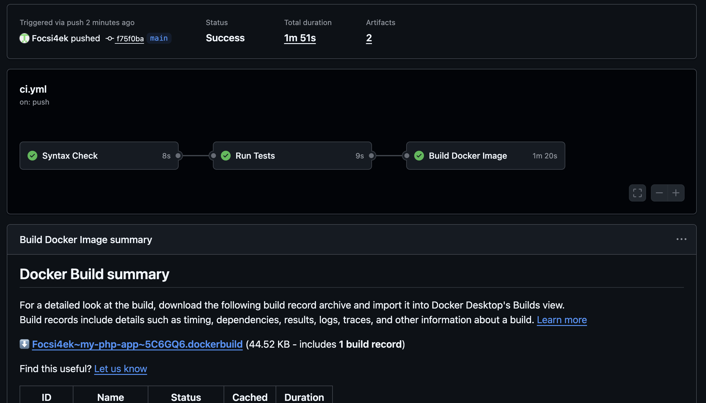
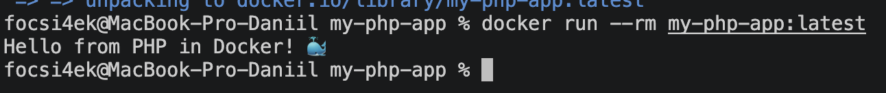

# 🐘 PHP CI Pipeline with GitHub Actions

**Автор:** Абрамов Даниил Сергеевич

Учебный проект для изучения **Continuous Integration (CI)** на примере простого PHP-приложения.

Проект автоматически проверяется с помощью **GitHub Actions**: выполняется проверка синтаксиса PHP, запускаются unit-тесты через PHPUnit, после успешного прохождения проверок собирается Docker-образ, сохраняется как Artifact и запускается для финальной проверки.

---

## 🎯 Цель проекта

Основная цель — настроить CI Pipeline для PHP-приложения и автоматизировать основные этапы проверки и сборки.

В рамках проекта реализованы:

- автоматический запуск CI при push
- запуск CI при Pull Request
- ручной запуск workflow
- проверка синтаксиса PHP
- запуск unit-тестов через PHPUnit
- контейнеризация приложения
- multi-stage Docker build
- запуск приложения от непривилегированного пользователя
- Docker Buildx
- кэширование Docker-сборки
- сохранение Docker-образа как Artifact
- автоматическая проверка запуска контейнера

---

## 🛠️ Используемые технологии

| Технология | Назначение |
|---|---|
| 🐘 PHP 8.2 | Основной язык приложения |
| ⚙️ GitHub Actions | Автоматизация CI |
| 🧪 PHPUnit | Unit-тестирование |
| 🐳 Docker | Контейнеризация приложения |
| 🏗️ Docker Buildx | Сборка Docker-образа |
| 📦 GitHub Artifacts | Хранение собранного Docker-образа |
| Git | Контроль версий |
| GitHub | Хранение проекта |

---

## 📁 Структура проекта

    my-php-app/
    ├── .github/
    │   └── workflows/
    │       └── ci.yml
    │
    ├── src/
    │   └── index.php
    │
    ├── tests/
    │   └── test.php
    │
    ├── Dockerfile
    ├── .dockerignore
    ├── README.md
    ├── 01-github-actions-success.png
    └── 02-docker-run-success.png

---

# 🐘 Приложение

Основной код находится в:

    src/index.php

Приложение содержит функцию:

    getGreeting()

Она возвращает строку:

    Hello from PHP in Docker! 🐳

Пример:

    <?php

    function getGreeting()
    {
        return "Hello from PHP in Docker! 🐳";
    }

    echo getGreeting() . PHP_EOL;

---

# 🧪 Unit-тесты

Для тестирования используется **PHPUnit**.

Тесты находятся в:

    tests/test.php

Проверяется:

- точное значение строки
- наличие слова `PHP`
- наличие слова `Docker`

Основной тест:

    $this->assertEquals(
        "Hello from PHP in Docker! 🐳",
        $greeting
    );

Дополнительно:

    $this->assertStringContainsString("PHP", $greeting);
    $this->assertStringContainsString("Docker", $greeting);

---

# 🔍 Проверка PHP-синтаксиса

До запуска тестов GitHub Actions выполняет проверку синтаксиса всех PHP-файлов.

Для исходного кода:

    find src -name "*.php" -exec php -l {} \;

Для тестов:

    find tests -name "*.php" -exec php -l {} \;

Команда:

    php -l

проверяет PHP-файл без его выполнения.

Если обнаруживается синтаксическая ошибка, Pipeline завершается с ошибкой.

---

# ⚙️ GitHub Actions

Workflow расположен по пути:

    .github/workflows/ci.yml

Название:

    PHP CI Pipeline

Pipeline запускается при:

    push

    pull_request

Также предусмотрен ручной запуск:

    workflow_dispatch

---

# 🔄 CI Pipeline

Общая схема:

    Developer
        │
        │ git push
        ▼
    GitHub Repository
        │
        ▼
    GitHub Actions
        │
        ▼
    ┌──────────────────────────────┐
    │        Syntax Check          │
    │                              │
    │      php -l src              │
    │      php -l tests            │
    └──────────────┬───────────────┘
                   │
                   │ Success
                   ▼
    ┌──────────────────────────────┐
    │          Run Tests           │
    │                              │
    │          PHPUnit             │
    └──────────────┬───────────────┘
                   │
                   │ Success
                   ▼
    ┌──────────────────────────────┐
    │      Build Docker Image      │
    │                              │
    │      Docker Buildx           │
    │      Save Artifact           │
    │      Run Container           │
    └──────────────┬───────────────┘
                   │
                   ▼
               ✅ Success

---

# 🚀 Этапы GitHub Actions

## 1. Checkout

GitHub Actions получает содержимое репозитория:

    actions/checkout@v4

---

## 2. Setup PHP

Для подготовки PHP используется:

    shivammathur/setup-php@v2

Версия:

    PHP 8.2

---

## 3. Syntax Check

Проверяется синтаксис PHP-файлов через:

    php -l

Это позволяет обнаружить ошибки ещё до запуска тестов.

---

## 4. PHPUnit

На этапе тестирования устанавливается PHPUnit:

    tools: phpunit

После чего запускается:

    phpunit tests/

---

## 5. Docker Build

После успешного тестирования собирается Docker-образ приложения.

Используется:

    docker/build-push-action@v6

Образ:

    my-php-app:latest

---

# 🔗 Зависимости между Jobs

Jobs выполняются последовательно.

Сначала:

    lint

После него:

    test

Затем:

    docker-build

Связь задаётся через:

    needs: lint

и:

    needs: test

Схема:

    Syntax Check
          ↓
    PHPUnit
          ↓
    Docker Build

Если один из этапов завершается ошибкой, последующие не запускаются.

---

# 🐳 Docker

Приложение контейнеризировано с использованием PHP 8.2 CLI.

Dockerfile использует два этапа.

---

## 🏗️ Multi-stage Build

Архитектура:

    ┌────────────────────────────┐
    │        php:8.2-cli         │
    │                            │
    │       Builder Stage        │
    └──────────────┬─────────────┘
                   │
                   ▼
            Copy PHP source
                   │
                   ▼
    ┌────────────────────────────┐
    │        php:8.2-cli         │
    │                            │
    │       Runtime Stage        │
    └──────────────┬─────────────┘
                   │
                   ▼
               appuser
                   │
                   ▼
         php ./app/index.php

---

# 🐳 Dockerfile

Основной Dockerfile:

    FROM php:8.2-cli AS builder

    WORKDIR /app

    COPY src ./src

    FROM php:8.2-cli

    RUN useradd --create-home appuser

    WORKDIR /home/appuser

    COPY --from=builder /app/src ./app

    USER appuser

    CMD ["php", "./app/index.php"]

---

# 🔐 Непривилегированный пользователь

В runtime-контейнере создаётся пользователь:

    appuser

После чего приложение запускается от его имени:

    USER appuser

Это безопаснее, чем запуск приложения от root.

---

# 🚫 .dockerignore

Для уменьшения Docker build context используются исключения:

    .git/
    .github/
    .gitignore
    .dockerignore
    *.md
    *.log
    Dockerfile
    tests/
    vendor/
    composer.*

В Docker-образ не попадают файлы, которые не нужны для запуска приложения.

---

# 🔨 Локальная сборка

Собрать Docker-образ:

    docker build -t my-php-app:latest .

Проверить образ:

    docker images | grep my-php-app

---

# ▶️ Запуск контейнера

Запуск:

    docker run --rm my-php-app:latest

Ожидаемый результат:

    Hello from PHP in Docker! 🐳

Параметр:

    --rm

автоматически удаляет контейнер после завершения работы.

---

# 🧪 Локальная проверка PHP

PHP необязательно устанавливать на macOS.

Проверить приложение можно через Docker:

    docker run --rm \
      -v "$(pwd):/app" \
      -w /app \
      php:8.2-cli \
      php src/index.php

Результат:

    Hello from PHP in Docker! 🐳

---

## 🔍 Локальная проверка синтаксиса

    docker run --rm \
      -v "$(pwd):/app" \
      -w /app \
      php:8.2-cli \
      php -l src/index.php

При корректном коде:

    No syntax errors detected in src/index.php

---

# 🏗️ Docker Buildx

В CI используется:

    docker/setup-buildx-action@v3

Docker Buildx позволяет использовать расширенные возможности Docker-сборки и кэш GitHub Actions.

---

# ⚡ Кэширование Docker

В workflow настроено:

    cache-from: type=gha
    cache-to: type=gha,mode=max

Это ускоряет последующие Docker-сборки за счёт повторного использования ранее созданных слоёв.

---

# 📦 Docker Image Artifact

После сборки Docker-образ сохраняется командой:

    docker save my-php-app:latest -o /tmp/docker-image.tar

Затем архивируется:

    gzip /tmp/docker-image.tar

Полученный файл:

    docker-image.tar.gz

сохраняется в GitHub Actions как Artifact с именем:

    docker-image

Срок хранения:

    7 дней

---

# 🧪 Проверка Docker-образа в CI

После сборки GitHub Actions автоматически запускает готовый контейнер:

    docker run --rm my-php-app:latest

Это позволяет проверить не только сборку, но и фактический запуск приложения.

---

# 🖥️ Результат GitHub Actions

После push Pipeline запускается автоматически.

Успешно должны завершиться:

- Syntax Check — ✅
- Run Tests — ✅
- Build Docker Image — ✅
- Upload Artifact — ✅
- Test Docker Image — ✅

---

# 🐳 Результат локального запуска

Локально приложение запускается командой:

    docker run --rm my-php-app:latest

Результат:

    Hello from PHP in Docker! 🐳

---

# ✅ Что проверяет CI

| Этап | Инструмент |
|---|---|
| Получение исходного кода | actions/checkout |
| Установка PHP | setup-php |
| Проверка синтаксиса | php -l |
| Unit-тесты | PHPUnit |
| Docker Builder | Docker Buildx |
| Сборка образа | Docker |
| Сохранение образа | upload-artifact |
| Проверка запуска | docker run |

---

# 📌 Continuous Integration

Continuous Integration позволяет автоматически проверять каждое изменение проекта.

Разработчик выполняет:

    git push

После этого GitHub Actions автоматически выполняет:

    Checkout
        ↓
    Setup PHP
        ↓
    Syntax Check
        ↓
    PHPUnit
        ↓
    Docker Build
        ↓
    Save Artifact
        ↓
    Run Container
        ↓
      ✅ Success

---

# 🔁 Повторный запуск Pipeline

После изменения проекта:

    git add .
    git commit -m "Update PHP application"
    git push

GitHub Actions автоматически запускает новый Pipeline.

Также его можно запустить вручную:

**GitHub → Actions → PHP CI Pipeline → Run workflow**

---

# 🟢 Успешный результат

Успешное выполнение Pipeline подтверждает, что:

- PHP-код не содержит синтаксических ошибок
- unit-тесты проходят
- Dockerfile корректен
- Docker-образ успешно собирается
- Artifact создаётся
- контейнер запускается без ошибок
- приложение выводит ожидаемый результат

---

# 📚 Полученные навыки

В рамках проекта были освоены:

- создание CI Pipeline для PHP
- работа с GitHub Actions
- настройка PHP 8.2
- проверка синтаксиса через php -l
- работа с PHPUnit
- контейнеризация PHP-приложения
- multi-stage Docker build
- запуск приложения от непривилегированного пользователя
- Docker Buildx
- кэширование Docker-сборок
- сохранение Docker-образа как Artifact
- автоматический запуск контейнера после сборки
- настройка зависимостей между GitHub Actions Jobs

---

# 🎯 Итог

В проекте создан учебный **CI Pipeline для PHP-приложения**.

GitHub Actions автоматически проверяет синтаксис PHP-кода, запускает PHPUnit-тесты, собирает Docker-образ, сохраняет его как Artifact и выполняет проверочный запуск контейнера.

Итоговая схема:

    Code
      ↓
    Syntax Check
      ↓
    PHPUnit
      ↓
    Docker Build
      ↓
    Artifact
      ↓
    Container Test
      ↓
    ✅ Success

Проект демонстрирует практический пример построения CI для PHP с использованием **GitHub Actions, PHPUnit и Docker**.

---

## 👨‍💻 Автор

**Абрамов Даниил Сергеевич**

**PHP CI Pipeline © 2026**